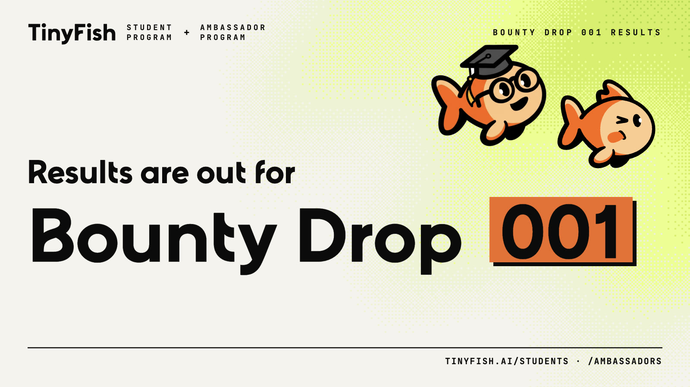

# Bounty Drop 001 Winners

The winning builds from the first Bounty Drop of the [TinyFish Student Program](https://tinyfish.ai/students) and [Ambassador Program](https://tinyfish.ai/ambassadors).

Students and ambassadors had 18 days to build real agents on the live web with TinyFish. The drop drew 230+ claims and 75+ submissions across five bounties. Each bounty was judged on a shared rubric (the basics, the bounty's own checklist, then a score out of 100), and the top three builds in each won.

Every project below is open source or has a public demo, so you can see how it uses TinyFish and build on it.

## Careers Finder

> Build a TinyFish-powered job and internship finder. Pull live openings from company careers pages and job portals, and match them to what the user is looking for.

| Place | Project | Builder | What it does | Links |
|-------|---------|---------|--------------|-------|
| 🥇 1st | **Openings** | Nicolas Dangg, Vinschool (Vietnam) | Reads hundreds of live postings across job boards, ranks and deduplicates them, and flags new jobs on every rescan. | [Code](https://github.com/NicolasDangg/job-portal-career-finders) · [Live](https://job-portal-career-finders.vercel.app/) |
| 🥈 2nd | **FirstRole** | Hamdan Esmail, UAE University | Honest job results, with clear empty and failed states and real safety and cost controls built in. | [Code](https://github.com/HamdanEsmail/firstrole) · [Live](https://firstrole.hamdanesmail12-7a9.workers.dev/) |
| 🥉 3rd | **Job Finder** | PunyBanner, University of Liverpool | One plain-English sentence searches career pages across six job platforms. | [Code](https://github.com/baigashad-in/job-finder) · [Demo](https://x.com/punybanneru4o/status/2107868275996549373) |

## SEO Page Auditor

> AI search is changing how pages get found. Build an auditor that checks whether AI search and fetch tools can actually read and understand a page, and what to fix.

| Place | Project | Builder | What it does | Links |
|-------|---------|---------|--------------|-------|
| 🥇 1st | **What AI Sees** | PunyBanner, University of Liverpool | Shows how AI crawlers really see your page, using Search, Fetch, Agent and Browser, each with a distinct job. | [Code](https://github.com/baigashad-in/AI-SEO-Page-Auditor) · [Demo](https://youtu.be/_HPmcFgIDMw) |
| 🥈 2nd | **SignalScope** | Chethan V. Tippani, University of Auckland | Compares what Google shows with what AI tools actually extract from a page. | [Code](https://github.com/Chethan-4255/signalscope_tinyfish.ai) · [Live](https://signalscope-tinyfish-ai.vercel.app/) |
| 🥉 3rd | **PageProof** | Himanshu Kumar, KMC Language University (India) | Ten careful checks, safe by default: every request validated and spend capped. | [Demo](https://x.com/jhahimanshu653/status/2110603891473814010) |

## Brand Guide Generator

> Give it a company's website and get back a usable brand guide: logo, colour palette, typography, tone of voice and key messaging, pulled from the live site.

| Place | Project | Builder | What it does | Links |
|-------|---------|---------|--------------|-------|
| 🥇 1st | **BrandKit** | Aditya Kumar, SSTC Bhilai (India) | A full brand guide from just a name or a URL, with TinyFish Fetch doing the reading, exported to Figma, Tailwind and CSS. | [Code](https://github.com/GxAditya/brandguide) · [Demo](https://x.com/kaditya264/status/2107796787176337649) |
| 🥈 2nd | **Brand Guide Generator** | Krishna Kanojiya, IU International University (Germany) | Brand guides plus design tokens, with saved-guide history, tested on brands like Linear and MongoDB. | [Code](https://github.com/kkrishna-labs/brand-guide-tiny-fish) · [Demo](https://x.com/kkrishna_labs/status/2110746291391336815) |
| 🥉 3rd | **Brand Guide Generator** | Edward, Douglas College (Canada) | Pulled GOV.UK's real blue and typeface in under a minute, and works on any brand. | [Code](https://github.com/giaphutran12/brand-guide-generator) |

## AI Assistant on iMessage

> Built with Photon. Build a working AI assistant that lives in iMessage: it texts you, remembers you, researches the live web and gets things done. Photon is the messaging layer, TinyFish is the web layer.

| Place | Project | Builder | What it does | Links |
|-------|---------|---------|--------------|-------|
| 🥇 1st | **Scout** | Arya Pradhan, UNC Chapel Hill (USA) | A study copilot that texts you before your deadlines, with live Search, Fetch and Agent calls behind the conversation. | [Code](https://github.com/arya-pradhan/Scout) · [Live](https://scout-site-eight.vercel.app/) · [Demo](https://x.com/the_aryap/status/2106179999829209177) |
| 🥈 2nd | **Lodge** | Hamdan Esmail, UAE University | Send a syllabus link, get back what's due, with scheduling and quiet hours. | [Code](https://github.com/HamdanEsmail/coursesignal) · [Live](https://coursesignal-bzb.pages.dev/) · [Demo](https://x.com/DoomedFaz/status/2106819529187663876) |
| 🥉 3rd | **Sage** | Vivek Salwan, Brock University (Canada) | Forward a sketchy text and it checks the live web for scams, then replies with cited sources. | [Code](https://github.com/VivekSalwan2000/sage) · [Demo](https://x.com/VivekSalwan0/status/2110979183665086483) |

Thank you to Photon for partnering with us on the iMessage bounty and giving our community a free month of Photon to build with.

## Build the next one

Bounty Drop 002 opens on Sun 1 Nov.

1. Join the [Student Program](https://tinyfish.ai/students) (sign up with your school email for $35 in credits) or the [Ambassador Program](https://tinyfish.ai/ambassadors).
2. Sign up with the same email on [TinyBounties](https://tinybounties.com).
3. Claim a bounty and build away.

Questions? Come say hi on the [TinyFish Discord](https://discord.gg/tinyfish).
