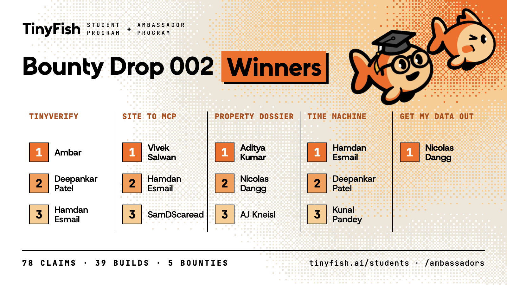

# Bounty Drop 002 Winners

The winning builds from the second Bounty Drop of the [TinyFish Student Program](https://tinyfish.ai/students) and [Ambassador Program](https://tinyfish.ai/ambassadors).

Students and ambassadors had 16 days to build real agents on the live web with TinyFish. The drop drew 78 claims and 39 submissions across five bounties. Each bounty was judged on a shared rubric (the basics, the bounty's own checklist, then a score out of 100), and the top three builds in each won. To spread the prizes, each builder could win at most two first places, two second places and one third place, and a launch bounty win counted as a first place.

Every project below is open source, so you can see how it uses TinyFish and build on it.

The TinySet and TinyResearch launch bounties ran separately. Their winners are in [TinySet + TinyResearch Launch Bounty Winners](../TinySet_TinyResearch_Launch_Bounty_Winners).

## TinyVerify

> Is this doctor licensed? Is this contractor in good standing? Is this company still registered? Build a TinyFish tool that takes a person or business, the licence or record type and the place, returns a verified record from the official source, and watches it for changes.

| Place | Project | Builder | What it does | Links |
|-------|---------|---------|--------------|-------|
| 1st | **TinyVerify** | Ambar, National University of Singapore | Checks whether a doctor, contractor or company is real at the official register, returns the record with a link, and watches it for changes. | [Code](https://github.com/Ambar-13/tinyverify) · [Post](https://x.com/ambar_prime/status/2121978500743913601) |
| 2nd | **Verity** | Deepankar Patel, Galgotias University (India) | Verifies licences and company registrations at the official registry, then watches the records for real changes. | [Code](https://github.com/dpp0007/Verity) · [Demo](https://x.com/bit_devop/status/2122608025160896548) |
| 3rd | **Standing** | Hamdan Esmail, UAE University | Answers in one status word, in the register's own wording, with a screenshot and source link from six official registries. | [Code](https://github.com/HamdanEsmail/standing) · [Live](https://standing.hamdanesmail12-7a9.workers.dev) · [Demo](https://x.com/DoomedFaz/status/2120078037572358591) |

## Site to MCP

> Most of the web has no API, so agents can't use it. Build a tool that turns a website with no API into a permanent agent tool: an MCP server with clear, typed inputs and outputs, with TinyFish doing the reading and clicking underneath.

| Place | Project | Builder | What it does | Links |
|-------|---------|---------|--------------|-------|
| 1st | **Stacks** | Vivek Salwan, Brock University (Canada) | Turns public library websites into 14 typed MCP tools, from catalogue search to shelf status by branch, using all five TinyFish endpoints. | [Code](https://github.com/VivekSalwan2000/stacks-mcp) · [Demo](https://x.com/VivekSalwan0/status/2122941942262866047) |
| 2nd | **Falaj** | Hamdan Esmail, UAE University | A remote MCP server that turns a university website into 10 tools, from the course catalogue to refund deadlines. | [Code](https://github.com/HamdanEsmail/falaj) · [Live](https://falaj.falaj.workers.dev) · [Demo](https://x.com/DoomedFaz/status/2120232533136937242) |
| 3rd | **CFP Scout** | SamDScaread, Shenzhen Technology University (China) | Wraps WikiCFP as an MCP server with 8 typed tools, and checks each conference deadline on the official site. | [Code](https://github.com/SamDScaread/cfp-scout) · [Post](https://x.com/SamDScareadreal/status/2121977419666215299) |

## Property Dossier

> Before anyone buys, builds on or renovates a property, someone digs through county and city websites by hand. Build a TinyFish tool that takes an address and returns a property dossier: permits, zoning, tax history, flood zone, violations and nearby schools, pulled live from official sources that have no API.

| Place | Project | Builder | What it does | Links |
|-------|---------|---------|--------------|-------|
| 1st | **SiteSpy** | Aditya Kumar, SSTC Bhilai (India) | Enter an address in Seattle, San Francisco or New York and it digs through city and county sites for permits, zoning, tax and schools, each linked to its source. | [Code](https://github.com/GxAditya/SiteSpy) · [Demo](https://x.com/kaditya264/status/2122640764635426933) |
| 2nd | **Lot & Block** | Nicolas Dangg, Vinschool (Vietnam) | A property dossier for any King County, WA address from seven official sources, as a report and a JSON API. | [Code](https://github.com/NicolasDangg/lotnblock) · [Live](https://lotnblock.vercel.app) · [Post](https://x.com/nicodalass/status/2117611230072553937) |
| 3rd | **TinyProperty** | AJ Kneisl, University of Minnesota (USA) | Permits, zoning, tax history, flood zone and nearby schools for a US address, with every record linked to its source and gaps listed instead of guessed. | [Code](https://github.com/ajkneisl/tiny) · [Live](https://tiny.umn.app/property) |

## Time Machine

> Pricing pages, policies and rules change quietly, and the old version is gone for good. Build a version-history API on TinyFish Monitor: watch pages that change, take a screenshot every time one changes, and let anyone ask what a page said on a given date and what changed between two dates.

| Place | Project | Builder | What it does | Links |
|-------|---------|---------|--------------|-------|
| 1st | **Fineprint** | Hamdan Esmail, UAE University | Keeps a dated history of pricing, fees, terms and privacy pages, with a screenshot and a word-level diff for every real change. | [Code](https://github.com/HamdanEsmail/fineprint) · [Live](https://fineprint.hamdanesmail12-7a9.workers.dev) · [Post](https://x.com/DoomedFaz/status/2119646441408974895) |
| 2nd | **Time Machine** | Deepankar Patel, Galgotias University (India) | Version history for any web page: a screenshot, text and diff for every real change, and you can ask what a page said on any date. | [Code](https://github.com/dpp0007/time-machine) · [Demo](https://x.com/bit_devop/status/2122609725313602021) |
| 3rd | **Pagipy** | Kunal Pandey, DSEU (India) | Tracks how websites change over time, with snapshots, a timeline and diffs. | [Code](https://github.com/pandey-kun7/pagipy) · [Post](https://x.com/pandey_kun/status/2118783973216428341) |

## Get My Data Out

> Your data is stuck in portals with no export button. Build a TinyFish agent that signs in to a portal you use, clicks through it, and exports everything into a clean CSV or JSON, plus any files it holds.

| Place | Project | Builder | What it does | Links |
|-------|---------|---------|--------------|-------|
| 1st | **gmdo** | Nicolas Dangg, Vinschool (Vietnam) | A command-line app that exports your Canvas grades, assignments and submitted files, tested on a real school account. | [Code](https://github.com/NicolasDangg/gmdo) · [Demo](https://x.com/nicodalass/status/2122510393503543757) |

## Build the next one

1. Join the [Student Program](https://tinyfish.ai/students) (sign up with your school email for $35 in credits) or the [Ambassador Program](https://tinyfish.ai/ambassadors).
2. Sign up with the same email on [TinyBounties](https://tinybounties.com).
3. Claim a bounty and build away.

Questions? Come say hi on the [TinyFish Discord](https://discord.gg/tinyfish).
