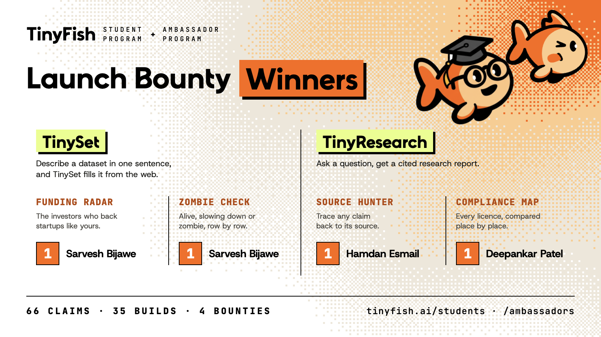

# TinySet + TinyResearch Launch Bounty Winners

The winning builds from the launch bounties for [TinySet](https://docs.tinyfish.ai/tinyset) and [TinyResearch](https://docs.tinyfish.ai/tinyresearch), open to the [TinyFish Student Program](https://tinyfish.ai/students) and [Ambassador Program](https://tinyfish.ai/ambassadors).

For the TinySet and TinyResearch launch on 5 Nov, we added four launch bounties, two built on each product. They drew 66 claims and 35 submissions. Each bounty had one winner, judged on the same rubric as the Bounty Drop: the basics, the bounty's own checklist, then a score out of 100.

Every project below is open source, so you can see how it uses TinyFish and build on it.

Looking for the Bounty Drop 002 winners? They're in [Bounty Drop 002 Winners](../Bounty_Drop_002_Winners).

## TinySet

Describe a dataset in one sentence, and TinySet fills it from the web. [Read the docs](https://docs.tinyfish.ai/tinyset).

### Funding Radar

> Every founder asks the same question: who would actually fund me? Build a TinyFish tool that takes a one-line description of a startup, finds companies like it that raised in the last 12 to 18 months, works out who backed them, and returns a ranked list of investors to approach, with proof for every match.

| Project | Builder | What it does | Links |
|---------|---------|--------------|-------|
| **Funding Radar** | Sarvesh Bijawe, VIT Pune (India) | Ranks investors from recent comparable deals, with linked proof, eligibility checks and JSON and CSV exports. | [Code](https://github.com/Sarvesh5273/funding-radar) · [Demo](https://x.com/Bijawe_Sarvesh/status/2122717694403514478) |

### Zombie Check

> Spreadsheets of companies, tools, vendors and job posts are full of zombies: still listed, but nobody home. Build a TinyFish tool that takes a spreadsheet of 500 or more rows and gives it back with a verdict on every row (alive, slowing down or zombie), checked against live pages.

| Project | Builder | What it does | Links |
|---------|---------|--------------|-------|
| **Zombie Check** | Sarvesh Bijawe, VIT Pune (India) | Audited 500 real job posts from Stripe, Datadog and Cloudflare, with a verdict, the latest activity and evidence links on every row. | [Code](https://github.com/Sarvesh5273/Zombie-Check) · [Demo](https://x.com/Bijawe_Sarvesh/status/2122711057559093703) |

## TinyResearch

Ask a question, get a cited research report. [Read the docs](https://docs.tinyfish.ai/tinyresearch).

### Source Hunter

> A statistic gets repeated across a hundred articles, and nobody checks where it came from. Build a browser extension with TinyFish underneath: highlight a number, claim or quote on any page, click once, and it traces the trail back to the original source, showing every step and flagging where the claim changed along the way.

| Project | Builder | What it does | Links |
|---------|---------|--------------|-------|
| **Upstream** | Hamdan Esmail, UAE University | A Chrome extension: highlight a claim on any page and it follows it back, source by source, showing what changed on the way. | [Code](https://github.com/HamdanEsmail/upstream) · [Demo](https://x.com/DoomedFaz/status/2121168798279684261) |

### Compliance Map

> Where should I set up? Opening a café, registering a company or running a drone business takes very different paperwork depending on the place. Build a TinyFish tool that takes one activity and compares at least three places side by side, pulled live from official government sites, with a recommendation for where it's easiest to start.

| Project | Builder | What it does | Links |
|---------|---------|--------------|-------|
| **Wayleave** | Deepankar Patel, Galgotias University (India) | Pick an activity and three to five places, and it lines up every licence, fee, approval time and renewal side by side, with a recommendation. | [Code](https://github.com/dpp0007/Wayleave) · [Demo](https://x.com/bit_devop/status/2122754166544322730) |

## Build the next one

1. Join the [Student Program](https://tinyfish.ai/students) (sign up with your school email for $35 in credits) or the [Ambassador Program](https://tinyfish.ai/ambassadors).
2. Sign up with the same email on [TinyBounties](https://tinybounties.com).
3. Claim a bounty and build away.

Questions? Come say hi on the [TinyFish Discord](https://discord.gg/tinyfish).
