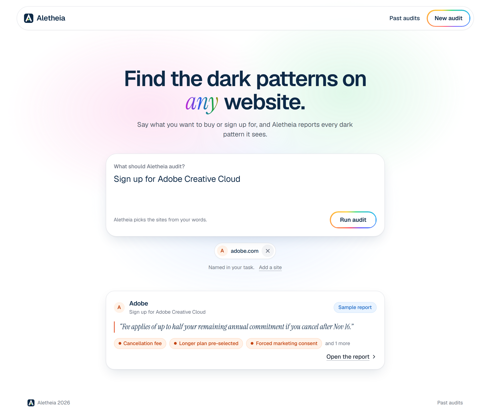
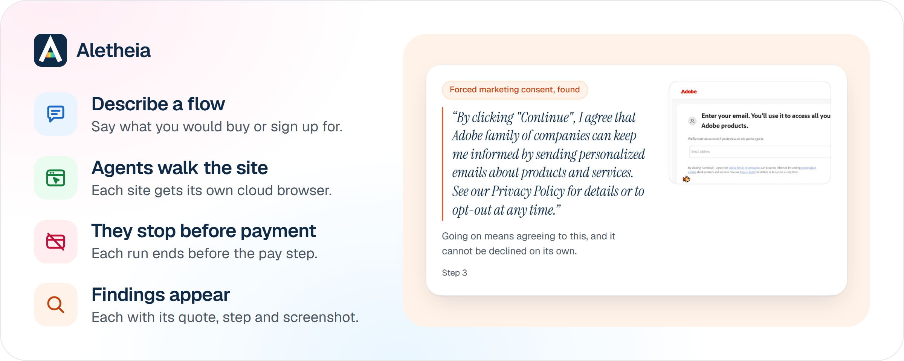
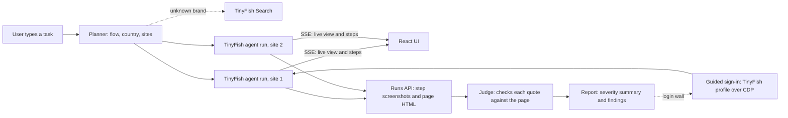

# Aletheia

Find the dark patterns on any website.

**Live:** [aletheia.romitraj.dev](https://aletheia.romitraj.dev) · **Sample report:** [Adobe Creative Cloud sign-up](https://aletheia.romitraj.dev/shared/hAsQ7yThlNCLvq8_7abW7n-mu33fzTpl) · **Source:** [github.com/brixdorf/aletheia](https://github.com/brixdorf/aletheia)

Describe a checkout or sign-up in plain words, such as "Sign up for Adobe Creative Cloud". Aletheia picks the sites, then TinyFish agents walk each flow like a real customer in a stealth cloud browser, stop before payment, and report every dark pattern they saw with its quote, its step and a screenshot. TinyFish runs every browser session in the app: streamed agent runs, step screenshots and page HTML from the runs API, browser profiles for an optional guided sign-in, and Search to find sites.

## Demo



The report opens with a severity summary, then lists each finding with the quote from the page, the step where it appeared and the screenshot of that step. Patterns on pages the agent never reached are marked "not checked", never "clean".

## TinyFish API usage

Each site gets one streamed agent run. The output schema asks for raw signals (prices, fees, timers, pre-ticked boxes, consent text, renewal terms, button wording), and the app decides what counts as a dark pattern. From [`server/src/tinyfish/client.ts`](server/src/tinyfish/client.ts):

```ts
const stream = await this.#sdk.agent.stream({
  url: request.url,
  goal: request.goal, // the flow, what to record at each step, and where to stop
  browser_profile: "stealth",
  proxy_config: {
    enabled: true,
    ...(request.proxyCountry ? { country_code: request.proxyCountry } : {}),
  },
  agent_config: { max_duration_seconds: request.maxDurationSeconds },
  // The page text is what lets a quote be checked rather than taken on trust.
  capture_config: { html: true },
  ...(request.outputSchema ? { output_schema: request.outputSchema } : {}),
  ...(request.profileId ? { use_profile: true, profile_id: request.profileId } : {}),
});

for await (const event of stream) {
  switch (event.type) {
    case "STREAMING_URL": // live browser view on the page
    case "PROGRESS": // each step as it happens
    case "COMPLETE": // hand the run to the judge
  }
}
```

| TinyFish feature                                                                                | What Aletheia uses it for                                                                                                                                                                                               |
| ----------------------------------------------------------------------------------------------- | ----------------------------------------------------------------------------------------------------------------------------------------------------------------------------------------------------------------------- |
| Agent runs, `POST /v1/automation/run-sse` (via `@tiny-fish/sdk`)                                | One run per site, with the stealth browser, a proxy in the user's country and HTML capture. The stream drives the live view and step list.                                                                              |
| `GET /v1/runs/{run_id}`                                                                         | Every step of a finished run, and reconnecting if a stream drops.                                                                                                                                                       |
| `POST /v1/runs/{run_id}/cancel`                                                                 | Enforces the app's own time limit.                                                                                                                                                                                      |
| `GET /v1/runs/{run_id}/steps/{step_id}/screenshot`                                              | The screenshot shown with each finding.                                                                                                                                                                                 |
| `GET /v1/runs/{run_id}/steps/{step_id}/html`                                                    | The saved page text that every quote is checked against.                                                                                                                                                                |
| Profiles: `POST /v1/profiles`, setup session start, save and cancel, `DELETE /v1/profiles/{id}` | The optional guided sign-in. The server drives the setup session's browser over CDP, the user answers one question at a time in Aletheia's own form, one signed-in run uses `use_profile`, then the profile is deleted. |
| Search                                                                                          | Finds the main sites for a product when a brand is not in the app's own list.                                                                                                                                           |

## How to run

You need [Node.js](https://nodejs.org) 26, [Bun](https://bun.sh) and a [TinyFish API key](https://agent.tinyfish.ai).

```bash
cd aletheia
cp .env.example .env   # then put your key in TINYFISH_API_KEY
bun install
bun run dev
```

Open [http://localhost:5173](http://localhost:5173). The web app proxies `/api` to the server on port 3000.

| Variable           | Required | What it is                                                                   |
| ------------------ | -------- | ---------------------------------------------------------------------------- |
| `TINYFISH_API_KEY` | Yes      | Your TinyFish API key. Never commit it.                                      |
| `PORT`             | No       | Server port, `3000` by default.                                              |
| `DATA_DIR`         | No       | Folder where audits, reports and screenshots are saved, `./data` by default. |

For production, `bun run build` builds the web app and `bun run start` serves it and the API from one Node process.

## Architecture





| Folder    | What is in it                                                                                                          |
| --------- | ---------------------------------------------------------------------------------------------------------------------- |
| `server/` | Hono API in TypeScript: planner, TinyFish client, run orchestration, the judge, report storage and the guided sign-in. |
| `web/`    | React and Tailwind front end: the audit box, live runs and reports.                                                    |

## Licence

MIT. Built by Romit Raj Sahu ([brixdorf](https://github.com/brixdorf)) and Abhijit P ([adx19](https://github.com/adx19)).
