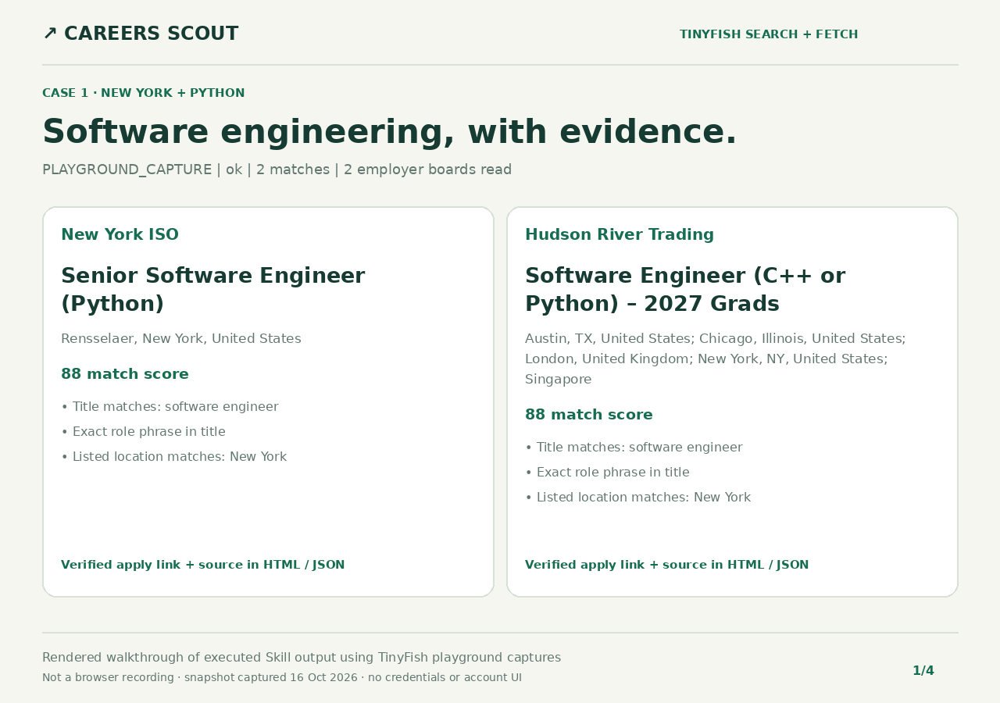

# Careers Scout

An installable agent Skill that finds jobs across real employer career sites. TinyFish **Search** discovers relevant postings; TinyFish **Fetch** reads their structured records. A standard-library Python helper filters, deduplicates, and ranks the results with application links and visible evidence.

**Live-validated default: Greenhouse.** Lever and Ashby are experimental opt-ins because the tested live Fetch responses lost their JSON structure. The helper reports those failures rather than inventing jobs.

## Demo links

- [Installable Skill entrypoint](SKILL.md)
- [Software engineer · New York · Python: HTML report](demo/software-new-york.html) · [JSON evidence](demo/software-new-york.json)
- [Product designer · London · Figma: HTML report](demo/design-london.html) · [JSON evidence](demo/design-london.json)
- [Validation record and limitations](demo/VALIDATION.md)

The HTML links are downloadable, timestamped reports from genuine TinyFish playground runs. Download and open them locally; this recipe is a Skill/CLI, **not a hosted continuously refreshed app**. There is no fabricated live-app URL.

### Demo walkthrough



The GIF is a rendered walkthrough of executed Skill output using real TinyFish playground Search → Fetch captures. It summarizes the exact report records; it is not a browser recording or a screen recording of REST execution. Captures are labeled accurately in the UI; account screens and credentials are excluded.

## Install and run

Requires Python 3.10+; no dependencies or second LLM API key.

Copy this directory into a skill-capable host's skills directory, for example `~/.codex/skills/careers-scout` or `~/.claude/skills/careers-scout`. Invoke `$careers-scout` with your role, location, and keyword preferences.

For direct REST execution, configure `TINYFISH_API_KEY` through your environment's secure secret mechanism. Never commit or paste a key into a command:

```bash
cd careers-scout
python3 scripts/careers.py \
  --role 'software engineer' --location 'New York' --keyword Python \
  --max-boards 6 --limit 10 --json output/jobs.json --html output/jobs.html
```

Open `output/jobs.html`. Try another preference set:

```bash
python3 scripts/careers.py \
  --role 'product designer' --location London --keyword Figma --country GB \
  --json output/design-jobs.json --html output/design-jobs.html
```

`--location` is a literal match: “New York” includes the state, not only NYC. `--country` localizes Search and does not imply job eligibility. Remote never means worldwide by default.

Already authenticated through TinyFish MCP or the browser playground? Follow [the capture transport](references/transports.md) to execute Search/Fetch there and process their exact responses without transferring a key. Modes distinguish `live` REST, `mcp_capture`, `playground_capture`, and synthetic `fixture` execution.

## TinyFish integration

The production adapter in [scripts/careers.py](scripts/careers.py) calls both endpoints. It never calls the ATS servers directly:

```python
client.search(query, country="US", language="en")
# GET https://api.search.tinyfish.ai?query=...&location=US&language=en
# X-API-Key is read from the environment and sent only to TinyFish.

client.fetch([target.feed_url for target in selected_targets])
# POST https://api.fetch.tinyfish.ai
# {"urls": [...], "format": "markdown", "ttl": 0,
#  "per_url_timeout_ms": 45000}
```

Search discovers postings for these preferences instead of using a fixed employer list. Fetch supplies job facts from individual public posting records whenever possible, avoiding large whole-board payloads. Agent is deliberately unused: this read-only task does not need paid browser interaction. This recipe claims **two meaningful TinyFish endpoints**.

`ttl=0` requests fresh retrieval; origin caching may still serve older content. A published posting is evidence of availability when observed, not a guarantee that it remains open.

## Architecture

```text
Role · Location · Keywords · Remote preference
                    |
       TinyFish Search (Greenhouse by default)
                    |
    validated employer posting URLs + provenance
                    |
     TinyFish Fetch (individual posting preferred)
                    |
     deterministic extraction + unknowns kept null
                    |
      hard filters -> rank -> canonical dedup
                    |
         HTML shortlist + JSON evidence
```

MCP/playground mode executes the same Search/Fetch stages through the authenticated host and imports genuine responses into the deterministic helper.

## Preferences and safeguards

- Repeat `--role` for alternatives, `--keyword` for ranking, and `--exclude` for phrases to reject
- `--require-keywords` makes every keyword mandatory; `--remote only` requires explicit remote evidence
- Optional `--board` URLs prioritize specific employer boards; `--max-boards 1..10` bounds retrieval
- Each job has match reasons, keyword excerpts, application URL, source URL, and observed time
- Unknown company, salary, work-mode, and date fields stay null; no visa or eligibility assumptions
- Same posting IDs/canonical links are deduplicated after filtering so a matching duplicate is not lost
- Partial failures, incomplete captures, unknown schemas, and unsupported pages are disclosed
- API credentials never enter reports; redirects cannot forward them; static HTML is escaped
- No résumé upload, account creation, employer outreach, or automated application

To opt into **experimental, not live-validated** providers, repeat `--provider`, for example `--provider greenhouse --provider lever --provider ashby`. Their parsers have synthetic tests, but current TinyFish rendering may remove structured fields. Unsupported responses yield errors. Full Lever board fallback is capped at 100 postings and warns about coverage.

## Offline demo and tests

```bash
python3 scripts/careers.py --role 'software engineer' --location 'New York' \
  --keyword Python --fixture examples/synthetic.json \
  --json output/synthetic.json --html output/synthetic.html

python3 -m unittest discover -s tests -v
python3 -m py_compile scripts/careers.py
```

The fixture is clearly labeled synthetic everywhere. It never proves live access or current vacancies. The test suite covers extraction, malformed data, ranking, URL safety, deduplication, partial failures, capture provenance, HTTP retries/redaction, CLI behavior, and HTML escaping. CI runs offline with Python 3.10 and 3.12.

## Files and license

`SKILL.md` is the agent workflow; `scripts/` contains the dependency-free implementation; `references/` documents transport and field contracts; `tests/` contains synthetic regressions; `demo/` contains sanitized live-data reports and their walkthrough. Raw provider responses and account screens are not published.

MIT, following the repository's [license](../LICENSE).
