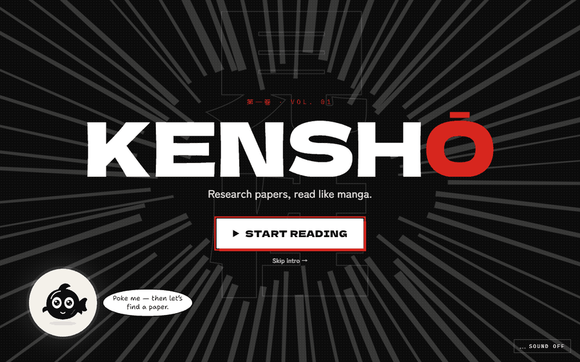
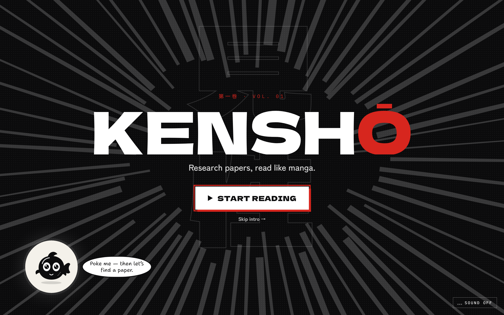
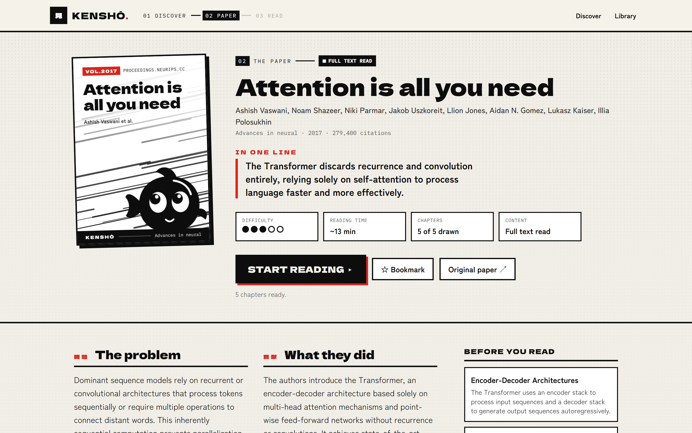
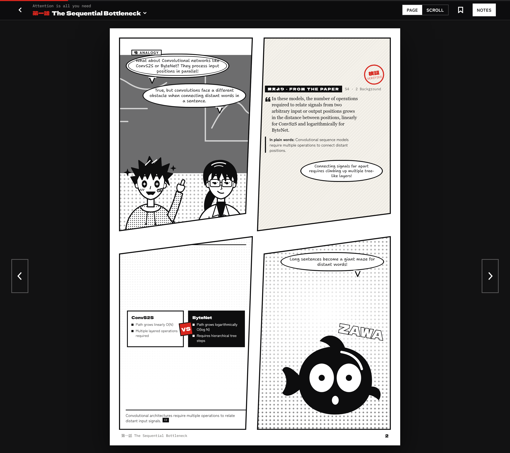

# Kensho (見性) — Research Papers, Read Like Manga

**Live: https://kensho-nt.vercel.app/**

Ask a question in plain English and Kensho finds real research papers, reads the one you pick, and redraws it as short manga chapters with recurring characters, interactive diagrams and key terms — every research claim linked to a verbatim quote from the paper. **TinyFish Search** discovers the papers, **TinyFish Fetch** reads their full text (HTML or PDF), and a **TinyFish Agent** steps in as a fallback to find an *openly accessible* copy when a publisher page blocks plain fetching.

Built for TinyHacks. The full story is in [BUILD_LOG.md](./BUILD_LOG.md).

---

## Demo



| Opening | Paper overview | A manga page |
|---|---|---|
|  |  |  |

---

## Where TinyFish is used

| Endpoint | Job in Kensho | Code |
|---|---|---|
| **Search** `GET api.search.tinyfish.ai` | 3 parallel searches per question: `domain_type=research_paper` (pages 1 and 2) + a web search limited to open repositories with `include_domains`. Also used for "related research" on each paper. | `src/server/discovery.ts` |
| **Fetch** `POST api.fetch.tinyfish.ai` | One call with up to 5 candidate URLs (arXiv HTML, arXiv PDF, PDF link, landing page) → clean markdown → Kensho keeps the longest real full text and splits it into sections. | `src/server/acquire.ts` |
| **Agent** `POST agent.tinyfish.ai/v1/automation/run-sse` | Only when Fetch can't reach full text: a browser agent looks for an openly accessible copy (never logs in, pays, solves CAPTCHAs or bypasses paywalls). Its streamed steps are shown to the reader live. | `src/server/acquire.ts` |

### Snippet: the TinyFish client (`src/server/tinyfish.ts`)

```ts
const SEARCH_URL = "https://api.search.tinyfish.ai";
const FETCH_URL = "https://api.fetch.tinyfish.ai";
const AGENT_SSE_URL = "https://agent.tinyfish.ai/v1/automation/run-sse";

// Search — e.g. search({ query, domain_type: "research_paper", purpose })
export async function search(params: SearchParams): Promise<SearchResult[]> {
  const qs = new URLSearchParams();
  for (const [k, v] of Object.entries(params)) if (v !== undefined && v !== "") qs.set(k, String(v));
  const res = await fetch(`${SEARCH_URL}?${qs}`, { headers: { "X-API-Key": key() } });
  if (!res.ok) throw await readError(res);
  return ((await res.json()) as { results?: SearchResult[] }).results ?? [];
}

// Fetch — all candidate URLs for a paper in one request
export async function fetchContent(urls: string[], opts: { purpose?: string; perUrlTimeoutMs?: number } = {}) {
  const res = await fetch(FETCH_URL, {
    method: "POST",
    headers: { "X-API-Key": key(), "Content-Type": "application/json" },
    body: JSON.stringify({ urls, format: "markdown", purpose: opts.purpose, per_url_timeout_ms: opts.perUrlTimeoutMs ?? 60_000 }),
  });
  if (!res.ok) throw await readError(res);
  return (await res.json()) as FetchResponse; // { results, errors } — per-URL failures don't fail the batch
}

// Agent — streamed run; PROGRESS events go to the reader's live log, COMPLETE returns the result
export async function runAgent(url: string, goal: string, onProgress?: (text: string) => void) {
  const res = await fetch(AGENT_SSE_URL, {
    method: "POST",
    headers: { "X-API-Key": key(), "Content-Type": "application/json", Accept: "text/event-stream" },
    body: JSON.stringify({ url, goal }),
  });
  // …reads `data:` lines: PROGRESS → onProgress(event.purpose), COMPLETE → return event.result
}
```

The Agent goal Kensho sends (`src/server/acquire.ts`, truncated):

```text
You are on the landing page of the research paper titled "<title>".
Find a link to the paper's FULL TEXT that is openly accessible without logging in or paying …
Do NOT log in, create accounts, accept purchase prompts, solve CAPTCHAs, or try to bypass any paywall.
If the full text requires a subscription or payment, stop and report that.
Return JSON exactly like: {"full_text_url": …, "abstract": …, "access": "open" | "paywalled" | "unknown", "note": …}
```

---

## How to run

Requires **Node 22.5+** (Kensho uses the built-in `node:sqlite`).

```bash
cd kensho
cp .env.example .env     # then fill in the keys below
npm install
npm run dev              # http://localhost:3000
```

| Variable | Required | What it's for |
|---|---|---|
| `TINYFISH_API_KEY` | yes | TinyFish Search, Fetch and Agent — https://agent.tinyfish.ai/api-keys |
| `GEMINI_API_KEY` | yes | Google Gemini, which extracts claims and writes the manga script — https://aistudio.google.com/apikey |
| `KENSHO_MODEL` | no | Gemini model to use first (default `gemini-3.8-flash`) |
| `KENSHO_FALLBACK_MODELS` | no | Models to fall back to when one hits its free-tier quota |
| `TINYFISH_AGENT_FALLBACK` | no | Set to `off` to never use the metered Agent fallback |

Data (searches, papers, generated chapters) is stored in `./data/kensho.db`, created on first run.

---

## Architecture

```
┌──────────────────────────────────────────────────────────────────────┐
│ Browser (Next.js App Router, React)                                  │
│  /            home: one search box                                   │
│  /search      live progress per TinyFish source → results            │
│  /paper/[id]  overview + "Read as manga"                             │
│  /read/[id]   manga reader (page / scroll), citation drawer, quiz    │
│               SVG cast, scenes, panel layouts, interactive diagrams  │
└───────────────┬──────────────────────────────────────────────────────┘
                │  /api/search?stream=1 (NDJSON progress)
                │  /api/papers/[id] · /process · /related
┌───────────────▼──────────────────────────────────────────────────────┐
│ src/server — research pipeline (server-only)                         │
│                                                                      │
│  discovery.ts ── TinyFish Search ×3 (parallel) ─┐                    │
│                  dedupe by arXiv id / DOI / title + arXiv abstracts  │
│                                                                      │
│  acquire.ts ──── TinyFish Fetch (≤5 candidate URLs, one call)        │
│                    │ full text? ──yes──► split into sections         │
│                    no                                                │
│                    ▼                                                 │
│                  TinyFish Agent (SSE) → open full-text link → Fetch  │
│                    │ still nothing → abstract-only mode (labelled)   │
│                                                                      │
│  analyze.ts ──── Gemini → claims + verbatim quotes, glossary, quiz,  │
│                  chapter plan; every quote checked against the text  │
│  storyboard.ts ─ Gemini → panels per chapter (validated: unknown     │
│                  refs dropped, chart numbers must be in a quote)     │
│  pipeline.ts ─── background job, saved after every stage, chapters   │
│                  drawn in parallel, failed chapters retryable        │
│  db.ts ───────── SQLite (node:sqlite)                                │
└──────────────────────────────────────────────────────────────────────┘
```

**Grounding rules:** research lines in the manga cite claim IDs; each claim shows its verbatim quote with a verified/unverified stamp; analogies are visibly tagged. Kensho only reads openly accessible text and links every page back to the original paper.
