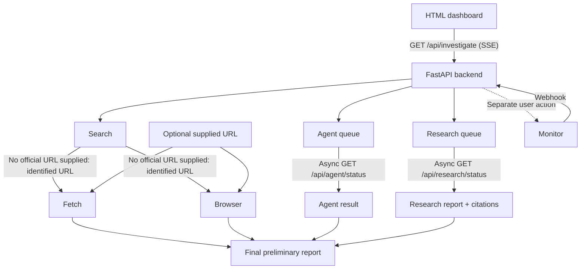

# LoanGuard

**Live application:** https://loanguard-five.vercel.app/

LoanGuard is a FastAPI dashboard that combines public-source evidence into
preliminary risk indicators for Indian instant-loan applications. TinyFish
provides web Search, RBI directory Agent navigation, page Fetch, visual
Browser evidence, cited Research, and optional Monitor support.

## Demo

Watch the live LoanGuard walkthrough:

[Watch LoanGuard Demo](demo/loanguard-demo.mp4)

The walkthrough demonstrates the six TinyFish capabilities,
the investigation timeline, risk assessment, visual evidence,
Research report, and optional monitoring.

## TinyFish integrations

All SDK-backed services use `AsyncTinyFish`. The live investigation starts
Search, Agent, and Research concurrently. Fetch and Browser start as soon as
an explicitly supplied website or a suitable URL identified by Search is
available. Agent and Research are queued first and retrieved asynchronously
through their status endpoints. Monitor is never created automatically.

### Search

`services/tinyfish_search.py` runs three focused queries and parses the
documented result fields:

```python
client = AsyncTinyFish(api_key=get_api_key(), timeout=20.0, max_retries=0)
resp = await client.search.query(q)
results = [_parse_result(r) for r in (getattr(resp, "results", None) or [])]
```

### Agent

`services/tinyfish_agent.py` queues an RBI directory check with a structured
schema. It returns a `run_id`; `client.runs.get(run_id)` retrieves the result
later without treating an unavailable directory as confirmed absence.

```python
response = await client.agent.queue(
    goal=build_goal(name),
    url=get_rbi_url(),
    output_schema=OUTPUT_SCHEMA,
)
response = await client.runs.get(run_id)
```

### Fetch

`services/tinyfish_fetch.py` fetches up to ten deduplicated public URLs as
Markdown and extracts transparency and complaint indicators from the returned
page text.

```python
resp = await client.fetch.get_contents(
    urls,
    format="markdown",
    links=True,
    per_url_timeout_ms=60_000,
)
```

### Browser

The Browser capability is used through its REST API because the current
implementation has no Browser SDK method. The service creates a remote
session with `POST https://api.browser.tinyfish.ai`, connects with
Playwright's `connect_over_cdp(cdp_url)`, saves the screenshot, and deletes
the session.

```python
resp = await http.post(BROWSER_API_URL, headers=headers, json=body)
browser = await p.chromium.connect_over_cdp(cdp_url)
```

### Research

Research is deep and asynchronous. LoanGuard queues one cited report and
returns immediately; the frontend later calls the status route, which uses
`client.research.get(run_id)` to retrieve `deep_result.result` and citations.

```python
response = await client.research.queue(
    query=build_query(name, site),
    mode="deep",
)
response = await client.research.get(run_id)
```

### Monitor

Monitor is an optional, user-triggered operation. Clicking the monitor action
calls `client.monitors.create` for the RBI starting page; it is not part of
every investigation.

```python
created = await client.monitors.create(
    "fetch",
    {"url": get_rbi_url(), "format": "markdown"},
    schedule_cron,
    purpose="Detect additions/changes to the RBI digital lending apps directory",
    webhook_url=webhook_url,
)
```

## Architecture



Search, Agent, and Research run concurrently. Search unlocks Fetch and
Browser when no official URL is supplied. Agent and Research results are
retrieved asynchronously and incorporated into the report when available.
Monitor is a separate user-triggered operation.

## Setup (Windows PowerShell)

From this `loanguard` directory:

```powershell
python -m venv .venv
.venv\Scripts\Activate.ps1
pip install -r requirements.txt
python -m playwright install chromium
Copy-Item .env.example .env
```

Edit `.env` and set `TINYFISH_API_KEY` to your own key:

```dotenv
TINYFISH_API_KEY=your_own_key
DEMO_MODE=1
RBI_DLA_URL=https://www.rbi.org.in/
PORT=8000
```

The required variables are:

- `TINYFISH_API_KEY`: your TinyFish API key; required only for live mode.
- `DEMO_MODE`: `1` for the local fixture, or `0` for live TinyFish calls.
- `RBI_DLA_URL`: Agent and Monitor starting page.
- `PORT`: port used when running `main.py` directly.

Start the application with:

```powershell
uvicorn main:app --host 0.0.0.0 --port 8000
```

Open http://127.0.0.1:8000. `DEMO_MODE=1` makes no TinyFish API calls and
uses fictional sample data. `DEMO_MODE=0` requires your own API key and may
consume TinyFish credits; do not use live mode for a smoke check unless you
intend to run paid/provider operations.

## Validation without live TinyFish jobs

The safe checks below do not create Agent, Research, or Monitor jobs:

```powershell
python -m compileall -q main.py services
pytest -q
```

The live service scripts from the original application are intentionally not
included in this cookbook contribution.

## Output and limitations

The report includes source evidence, RBI directory status, website
transparency indicators, complaint-keyword signals, optional screenshot
evidence, citations, and a heuristic score. Failed lookups remain unverified;
they are not reported as proof that an app is absent.

Results are preliminary risk indicators based on inspected public information,
not RBI certification, a lender approval, a guarantee of legitimacy, or legal
advice. Keyword detection and transparency checks are heuristics, public
pages may be incomplete, Research may remain queued, Browser access may fail,
and Monitor availability depends on the provider and account.

## Security

Only `.env.example` is included. Copy it to `.env` locally and never commit
that file, API keys, access tokens, browser session URLs, webhook secrets, or
personal data.
