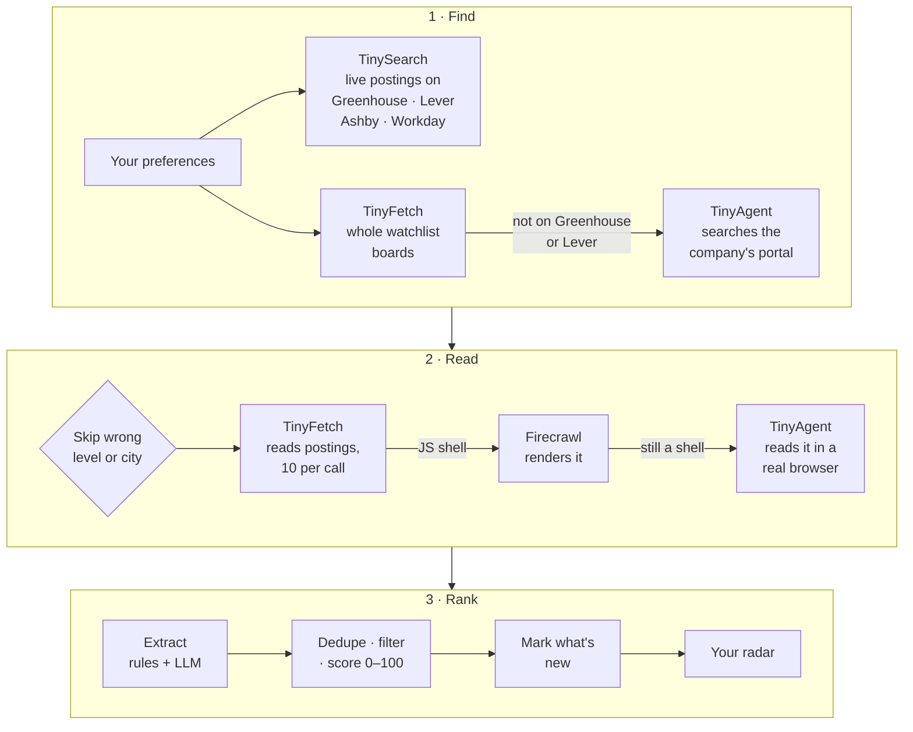

# Openings: a job radar for students

**Live app:** https://job-portal-career-finders.vercel.app

Tell Openings once what you're looking for: the role, internship or new grad, up to three cities (Remote counts), your class year, whether you need visa sponsorship, and the companies to watch. It goes to the live web, reads every posting, and returns a ranked, deduplicated shortlist with the term, pay, class years, visa status and a direct apply link. Every rescan flags what's new.

**TinySearch** finds live postings on Greenhouse, Lever, Ashby and Workday. **TinyFetch** reads postings 10 at a time and whole company boards in one call. **TinyAgent** uses careers portals that only work in a real browser, and the dashboard shows its live browser while it works.

Winner of 1st place in the Careers Finder bounty, [Bounty Drop 001](../Bounty_Drop_001_Winners).

## Demo


## How it calls TinyFish

**TinySearch: discover postings** (`src/lib/discover.ts`). One plain query per city and level word, limited to job-board domains:

```ts
const ATS_DOMAINS = ["job-boards.greenhouse.io", "boards.greenhouse.io", "jobs.lever.co", "jobs.ashbyhq.com", "myworkdayjobs.com"];

const { results } = await tinyfish().search.query({
  query: "software engineer intern New York",
  include_domains: ATS_DOMAINS.join(","),
  purpose: "Find currently open internship job postings for a student job search",
});
```

**TinyFetch: read postings, 10 per call** (`src/lib/read.ts`):

```ts
const { results } = await tinyfish().fetch.getContents({
  urls: batch, // up to 10 posting URLs
  format: "markdown",
  ttl: 3600,
  per_url_timeout_ms: 45_000,
  purpose: "Read a job posting: title, location, pay, dates, requirements, visa sponsorship",
});
```

**TinyAgent: use a JavaScript careers portal's own search** (`src/lib/agent.ts`). Runs are budgeted: at most 2 at once, 150 s timeout each.

```ts
const goal =
  `This is a company careers site. Find open job postings matching "${searchTerm}": ` +
  `use the site's search box or filters if it has them, otherwise scan the listed jobs. ` +
  `Return up to 10 matching postings as JSON: {"jobs":[{"title":str,"location":str,"posted":str,"url":str}]}. ` +
  `If the page is blocked, shows a captcha, or nothing matches, return {"jobs":[],"error":"<reason>"}.`;

const stream = await tinyfish().agent.stream(
  { url: portalUrl, goal },
  {
    signal: AbortSignal.timeout(150_000),
    onStreamingUrl: (e) => showLiveBrowser(e.streaming_url), // shown in the dashboard's Run log
  },
);

for await (const event of stream) {
  if (event.type === "COMPLETE" && event.status === "COMPLETED") {
    // COMPLETED doesn't always mean the goal succeeded, so check the "error" field the goal asks for.
    const ok = !event.result?.error;
  }
}
```

## How to run

Requires Node.js 22 or later.

```bash
cd openings
npm install
cp .env.example .env.local   # then fill in the keys below
npm run dev                  # http://localhost:3000
```

| Variable | Required? | What it's for |
|---|---|---|
| `TINYFISH_API_KEY` | Yes | TinySearch, TinyFetch and TinyAgent. Get one at [agent.tinyfish.ai](https://agent.tinyfish.ai). |
| `AI_GATEWAY_API_KEY` | Optional | LLM extraction through Vercel AI Gateway. Without it, Openings uses its tested regex rules only. |
| `EXTRACT_MODEL` | Optional | Which LLM to use (default `openai/gpt-4.1-mini`). |
| `FIRECRAWL_API_KEY` | Optional | Fallback if a search comes back empty or a page only renders as a JavaScript shell. |
| `DEEP_SEARCH_PASSCODE` | Production only | Locks deep search (TinyAgent) on a public deploy. Leave it empty locally. |

Other scripts:

```bash
npm test                     # extraction, board parsing, ranking, freshness and cost-guard tests
npm run pipeline -- --companies "figma,notion" --agent 2 --grad 2027 --visa   # the full pipeline in the terminal
```

## Architecture



| Path | What it does |
|---|---|
| `src/lib/pipeline.ts` | Runs a scan from start to finish |
| `src/lib/discover.ts` | TinySearch queries built from your preferences |
| `src/lib/boards.ts` | TinyFetch reads of whole Greenhouse and Lever boards |
| `src/lib/read.ts` | TinyFetch reads of postings |
| `src/lib/agent.ts`, `src/lib/portals.ts` | TinyAgent budget, portal search and posting reads |
| `src/lib/extract/` | Rules-first extraction, with an LLM on top |
| `src/lib/rank.ts` | Dedupe, hard filters with reasons, 0–100 score |
| `src/lib/freshness.ts` | What's new since your last scan |
| `src/app/api/run/route.ts` | Streams a scan to the browser as NDJSON |

More detail, including the gotchas and real numbers from test runs: [`docs/HOW-IT-WORKS.md`](./docs/HOW-IT-WORKS.md).

## License

[MIT](./LICENSE) © 2026 Nicolas Dangg
