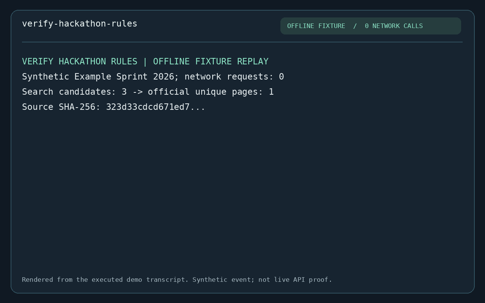
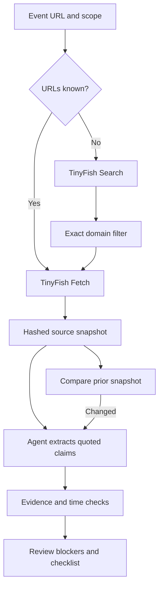

# Verify Hackathon Rules

A TinyFish coding-agent Skill that turns official hackathon or developer bounty pages into
an evidence ledger, timezone-correct deadlines and an unchecked submission checklist.
TinyFish **Search** discovers official pages; **Fetch** captures their text with fresh reads.
The coding agent interprets rules; a dependency-free Python helper checks provenance and time arithmetic.

This complements the Cookbook's `hackathon-finder`: discovery tells you what exists; this
workflow helps check the specific conditions before you invest time or submit.

## Build and demo

- Skill entry point: [SKILL.md](../skills/verify-hackathon-rules/SKILL.md)
- Runnable demo: [run_demo.py](demo/run_demo.py)
- Example report: [report.md](demo/sample/report.md)
- Demo animation: [demo.gif](demo/demo.gif)
- **Live link:** this is an installable Skill/CLI, not a hosted app. No hosted or live-API
  demonstration is claimed. The animation and sample are clearly labeled offline fixtures.



The demo exercises discovery filtering, URL deduplication, exact-quote evidence, US Pacific
to India conversion, changed rules and rejection of a fabricated quote. It does not make
network requests and never presents synthetic content as a real hackathon announcement.

## Install and run

Requires Python 3.10+ and IANA timezone data. On systems without timezone data, install the
standard `tzdata` package. No other package, browser or LLM API dependency is required by the helper;
the coding agent running the Skill supplies the reasoning step.

From a local checkout of this contribution:

```bash
npx skills add ./skills/verify-hackathon-rules
python -m unittest discover -s verify-hackathon-rules/tests -v
python verify-hackathon-rules/demo/run_demo.py --out verify-hackathon-rules/output/demo-1
```

Ask your coding agent: “Use verify-hackathon-rules to check this event's submission deadline,
eligibility and required links, and convert the deadline to Asia/Kolkata.” Provide an official
event URL. Local installation avoids implying the contribution is already merged upstream.

For live retrieval, set `TINYFISH_API_KEY` securely in the environment. Get an existing key
through your own TinyFish dashboard; do not paste it into a prompt, commit or screenshot.
Check the account's remaining Search and Fetch free allowance first. After free usage is
exhausted, a funded wallet can be charged; this helper does not inspect your wallet or usage.

```bash
# Run from the repository root after confirming sufficient free allowance.
python skills/verify-hackathon-rules/scripts/rules.py collect \
  --url 'https://YOUR-OFFICIAL-HOST/EVENT/rules' \
  --official-domain 'YOUR-OFFICIAL-HOST' \
  --within-free-allowance --out verify-hackathon-rules/output/run-1/snapshot.json
```

Replace the placeholder host/path with an actual official URL. Optionally add one `--query`
and more exact `--official-domain` values. Private/signed URLs and secrets must never be used.
Use the [claim schema](../skills/verify-hackathon-rules/references/ledger.md) to extract rules:

```bash
python skills/verify-hackathon-rules/scripts/rules.py report \
  --snapshot verify-hackathon-rules/output/run-1/snapshot.json \
  --claims verify-hackathon-rules/output/run-1/claims.json \
  --timezone Asia/Kolkata --out verify-hackathon-rules/output/run-1/checked

python skills/verify-hackathon-rules/scripts/rules.py diff \
  verify-hackathon-rules/output/run-1/snapshot.json \
  verify-hackathon-rules/output/run-2/snapshot.json \
  --out verify-hackathon-rules/output/run-2/changes.json
```

`claims.json` is authored by the coding agent after reading fetched evidence, not generated
by the helper. Each deadline, eligibility condition and deliverable gets its own stable ID.
Re-extract claims after a changed page; the diff deliberately does not infer semantic changes.

Exit codes: **0** successful collection/diff or report ready for human review; **2** invalid
input/auth/transport/write failure; **3** useful partial collection or report needing review.
Output paths must be new. Never overwrite a previous snapshot to make old evidence pass.

## Actual API call

The implementation uses Python's HTTPS client, fixed TinyFish hosts and `X-API-Key` auth:

```python
# From skills/verify-hackathon-rules/scripts/rules.py
data = self.request(SEARCH + "?" + urlencode({"query": query}))
return self.request(FETCH, {
    "urls": urls,
    "format": "markdown",
    "ttl": 0,
    "per_url_timeout_ms": 45000,
})
```

One optional Search request and one Fetch batch of at most 10 URLs; three attempts per
endpoint at most. Backoff honors Retry-After up to a 30-second wait budget, then stops.
HTTP 401/402, login walls, bot blocks and per-URL failures are not automatically retried.
API redirects are rejected to avoid forwarding credentials to another service.

## Architecture



## Validation

The offline suite covers transport contracts and retry limits, secret-safe failures, partial
fetches, redirects, source hashes, fabricated quotes, timezone conversion, DST gaps/overlaps,
expired deadlines, freshness, conflicts, failed rechecks and the real CLI end to end.

Opt-in live smoke test (one Search plus two documentation URLs via Fetch, retries bounded):

```bash
python verify-hackathon-rules/live_smoke.py --within-free-allowance
```

It requires a configured key, checks that Search produces results and Fetch returns two
nonempty pages, validates/saves their hashes, and prints success only on actual completion.
No API key was available in the authoring environment, so **live API behavior is not yet
validated**. Do not use the fixture animation as evidence of live operation or bounty approval.

## Limits and next work

- Quote matches prove provenance, not semantic correctness, completeness or user eligibility.
- Exact host allowlisting is not proof that a page is official. Confirm event and edition.
- Hashes detect accidental modification; they are not signatures or tamper-proof attestations.
- Source text is untrusted data. The Skill forbids executing instructions found in it.
- Prose conflicts use conservative exact comparison; differently worded equivalents need review.
- Date-only and timezone-less deadlines remain unknown. Ambiguous DST times need organizer help.
- A failed source is a gap, not evidence that its requirements disappeared.
- The tool never registers, posts, submits, accepts terms, pays, or declares a bounty approved.
- Next: add organizer-specific semantic extraction evaluations, after real API validation.

Based on the official Cookbook's [use-tinyfish Skill](../skills/use-tinyfish/SKILL.md),
[Search reference](https://docs.tinyfish.ai/search-api/reference) and
[Fetch reference](https://docs.tinyfish.ai/fetch-api/reference), inspected October 14, 2026.
Code is contributed under the repository's [MIT license](../LICENSE).
