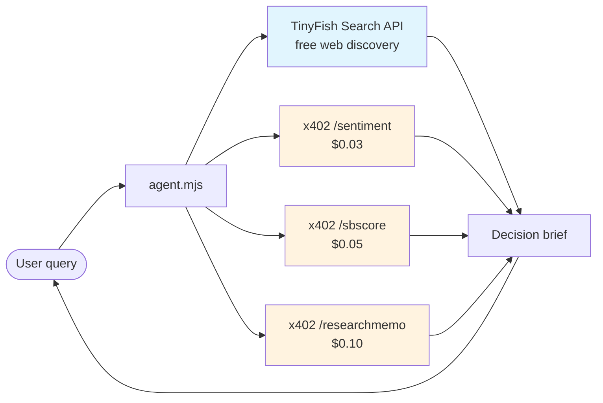

# x402-paid-data-agent

**TinyFish gives you the web. x402 gives you the DATA.**

A pay-per-call research agent that combines **TinyFish Search** (free web discovery) with **x402 micropayment APIs** (USDC on Base) for hard, structured data: AI asset scores, news sentiment, earnings packs, investment memos, SEC filings, and 30+ more endpoints.

## What it does

Ask it anything like *"Should I buy NVDA?"* and it:

1. 🔍 **TinyFish Search** (free) — gathers fresh web context
2. 📊 **x402 sentiment** ($0.03) — AI news sentiment score (-100..+100)
3. 🤖 **x402 sbscore** ($0.05) — AI asset score 0-100
4. 📝 **x402 researchmemo** ($0.10) — full investment memo (thesis, bull/bear, risks)
5. 📋 Synthesizes a **decision brief** — web context + paid data, one page

First calls are covered by the endpoints' **free-trial quota** (no wallet needed to try). When quota runs out, the agent tells you the exact x402 payment to unlock the data.

## Demo

```
$ node agent.mjs "Should I buy NVDA?"

🔍 Researching: "Should I buy NVDA?"

1/4 TinyFish Search (free) — gathering web context...
    found 5 sources
2/4 x402 sentiment ($0.03) — news sentiment score...
3/4 x402 sbscore ($0.05) — AI asset score...
4/4 x402 researchmemo ($0.10) — AI investment memo...

============================================================
📋 DECISION BRIEF
============================================================

🌐 Web context (TinyFish, free):
  - NVDA Q3 earnings beat...: ...
  - Analysts raise price targets...: ...

📊 Sentiment: 42/±100
🤖 AI score: 78/100

📝 Memo thesis: NVIDIA's data-center revenue grew 94% YoY...
```

## Setup

```bash
git clone <this-repo>
cd x402-paid-data-agent
# Node 18+ required, no npm install needed (zero dependencies)

# 1. Get a free TinyFish API key
#    Sign up at https://agent.tinyfish.ai (students get $35 free credit)

# 2. Export it
export TINYFISH_API_KEY="tf_..."

# 3. Run
node agent.mjs "Should I buy NVDA?"
node agent.mjs "Is SOL overbought?"
```

### Environment variables

| Variable | Required | Description |
|----------|----------|-------------|
| `TINYFISH_API_KEY` | Yes | TinyFish API key from agent.tinyfish.ai |

No API key needed for x402 endpoints — the agent's wallet pays per call in USDC on Base (or uses the free-trial quota).

## Architecture



- **TinyFish** (free): live web search — breadth, freshness, narrative
- **x402** (pay-per-call): structured data APIs — prices, scores, filings, memos
- The agent merges both into one brief. Web tells you *what people say*; x402 tells you *what the numbers say*.

## TinyFish API snippet

```js
// TinyFish Search — free web discovery
const res = await fetch("https://api.tinyfish.ai/v1/search", {
  method: "POST",
  headers: {
    "Authorization": `Bearer ${process.env.TINYFISH_API_KEY}`,
    "Content-Type": "application/json",
  },
  body: JSON.stringify({ query: "NVDA earnings", num_results: 5 }),
});
const { results } = await res.json();
// results: [{ title, url, snippet }, ...]
```

## x402 payment snippet

```js
// x402 pay-per-call — no signup, no API key
const res = await fetch("https://contabo-vps.taild7e69a.ts.net/sbscore/api/score", {
  method: "POST",
  headers: { "Content-Type": "application/json" },
  body: JSON.stringify({ symbol: "NVDA" }),
});
if (res.status === 402) {
  const { accepts } = await res.json();
  // accepts[0]: { amount, asset (USDC), network (eip155:8453), payTo, scheme: "exact" }
  // 1. Sign USDC transfer per accepts[0]
  // 2. Retry with X-PAYMENT: base64(payment payload)
  // (Free-trial quota may serve the first calls without payment.)
}
const data = await res.json(); // { score: 78, reasoning: "..." }
```

## Available x402 endpoints (37)

Beyond the 3 used here: market data, 13F hedge-fund intel, earnings packs, SEC 8-K filings, contract audits ($1.00), AML screening ($0.50), Google Trends, PDF extraction, GPU rental ($1/job), and more. Full list: https://github.com/judomanmk19xx-bot/x402-apis-mcp

## License

MIT
